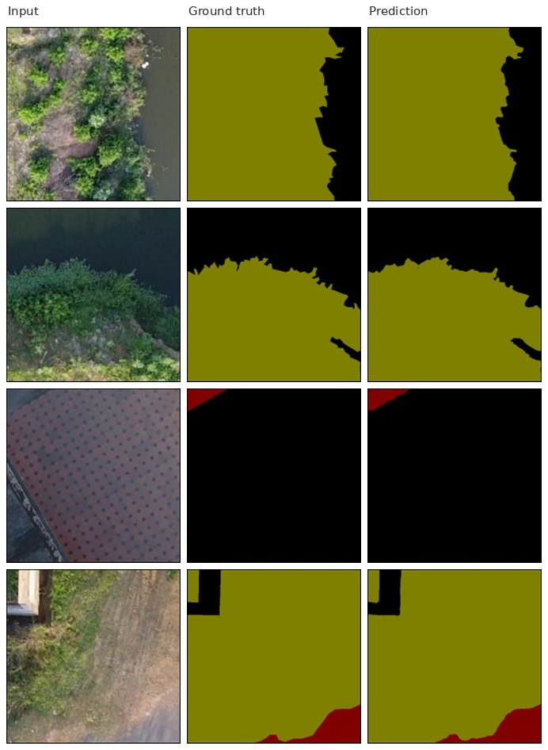

# LW-AerialSegNet

**A lightweight separable encoder-decoder for multi-object segmentation of UAV aerial imagery**

Tanmay Kumar Behera, National Institute of Technology Mizoram

---

## Overview

AerialSegNet labels every pixel of a low-altitude drone frame as background,
road, occluded road or vegetation. It was built for road extraction in
cluttered semi-rural scenes, where the road surface is routinely hidden under
canopy or shadow and the usable track is narrow relative to the frame.

Every convolution in the network is depthwise separable, so the whole model is
2,486,562 parameters and 9.49 MB of float32 weights. That is small enough to
run on an onboard compute module rather than a ground station.

The network is a five-stage U-shape. Each stage is a `StagedLayer`: two
separable convolutions in series, with the first output concatenated onto the
second, which doubles the channel count and gives a dense-style shortcut
without the parameter cost of a DenseNet unit.

| Resolution | Encoder | Out ch. | Skip | Decoder | Out ch. |
|---|---|---|---|---|---|
| 480 x 480 | `StagedLayer(3 -> 32)` | 64 | -> | `Up(128 -> 64)` | 64 |
| 240 x 240 | `Down(64 -> 64)` | 128 | -> | `Up(256 -> 128)` | 128 |
| 120 x 120 | `Down(128 -> 128)` | 256 | -> | `Up(512 -> 256)` | 256 |
| 60 x 60 | `Down(256 -> 256)` | 512 | -> | `Up(1024 -> 512)` | 512 |
| 30 x 30 | `Down(512 -> 512)` | 1024 | bottleneck | | |

Downsampling is 2x2 max pooling. Upsampling uses a learned `ConvTranspose2d`
that cuts the channel count to a quarter before the skip is concatenated, so
the decoder stays narrower than the encoder at every matching resolution.



## Get started

### Environment

```bash
conda create -n aerialsegnet python=3.10
conda activate aerialsegnet
pip install -r requirements.txt
```

### Data

The loader expects one directory per split, with images and masks paired by
sorted filename:

```
datasets/NITRDrone/
    train_images/   train_masks/
    val_images/     val_masks/
    test_images/    test_masks/     # optional
```

Masks are single-channel images whose pixel value is the class index:

| Index | Class | Mask colour in the figures |
|---|---|---|
| 0 | background | black |
| 1 | road | dark red |
| 2 | occluded road | green |
| 3 | vegetation | olive |

Point the config at your copy with `--data.data_path /path/to/NITRDrone`.

### Training and evaluation

```bash
# train with the published configuration
python train.py --config configs/exp/aerialsegnet_nitrdrone.yaml

# evaluate a checkpoint, no training
python train.py --config configs/exp/aerialsegnet_nitrdrone.yaml \
    --eval_only --ckpt_path checkpoints/aerialsegnet_nitrdrone_best.pth

# one short epoch to check the pipeline before committing a GPU
python train.py --config configs/exp/aerialsegnet_nitrdrone.yaml --dev
```

Training writes `history.json`, `history.csv` and `metrics.json` under
`results/<config_tag>/`, and saves the best-validation-mIoU checkpoint to
`checkpoints/`. Add `--save_predictions` to dump image, ground-truth and
prediction triplets after evaluation.

### Inference on new frames

```bash
python predict.py --ckpt checkpoints/aerialsegnet_nitrdrone_best.pth \
    --input path/to/frames --output predictions --img_size 480
```

`--save_index` also writes the raw class-index map alongside the colour mask.

## Configuration

Experiments live in `configs/exp`. Start from
`configs/exp/aerialsegnet_nitrdrone.yaml`, which is commented field by field.
Any field can be overridden on the command line:

```bash
python train.py -c configs/exp/aerialsegnet_nitrdrone.yaml \
    --train.epochs 50 --data.batch_size 2 --model.head_activation mish
```

Configs also layer, with later files winning:

```bash
python train.py -c configs/exp/aerialsegnet_nitrdrone.yaml \
                -c configs/exp/ablation/augmented.yaml
```

`python train.py -h` prints every argument.

| Config | What it changes |
|---|---|
| `exp/aerialsegnet_nitrdrone.yaml` | the published setup, recommended starting point |
| `exp/reproduce_notebook.yaml` | exact notebook loop, see *Differences* below |
| `exp/activation/{mish,prelu,linear_head}.yaml` | output-head activation |
| `exp/optim/adam_cosine.yaml` | Adam with cosine annealing instead of RAdam with plateau |
| `exp/ablation/augmented.yaml` | adds the flip and rotation transforms |
| `exp/ablation/tiny.yaml` | half-width model, 16 base channels |

Transforms are applied to the image and the mask through the same pipeline, so
`data.train_transforms` accepts geometric operations only. Anything that
changes pixel intensity is rejected with an error rather than silently
corrupting the labels.

## Benchmarking

```bash
python benchmark.py --img_size 480 --batch_size 1 --runs 50
```

Reports parameter count, weight size, latency and throughput, plus peak CUDA
memory when a GPU is present.

## Results

Final stage, 150 epochs on NITRDrone, 2452 train and 510 validation frames at
480x480.

| Split | Loss | mIoU | F1 | Precision | Recall | Accuracy |
|---|---|---|---|---|---|---|
| Train, final epoch | 0.0190 | 0.8898 | 0.8992 | 0.9847 | 0.9021 | 0.9961 |
| Validation, final epoch | 0.0278 | 0.6086 | 0.6558 | 0.8759 | 0.7044 | 0.9931 |
| Validation, best | 0.0235 | 0.6194 | 0.6651 | 0.9007 | 0.7279 | 0.9945 |

Best validation mIoU and F1 both land at epoch 51; the remaining 100 epochs do
not improve them.

Per-class, measured on the validation batch at the final epoch:

| Class | IoU | Dice | Precision | Recall |
|---|---|---|---|---|
| Background | 0.4998 | 0.6665 | 0.5783 | 0.7864 |
| Road | 0.9756 | 0.9876 | 0.9783 | 0.9971 |
| Occluded road | 0.0000 | 0.0000 | n/a | 0.0000 |
| Vegetation | 0.9858 | 0.9929 | 0.9968 | 0.9890 |

Three things are worth stating plainly rather than burying:

- **Occluded road never learns.** Its IoU is zero for the whole run despite a
  loss weight of 48. The precision cell is blank because the model predicts
  that class almost nowhere, so the denominator collapses and the 1.0 the raw
  code prints is meaningless. This looks like label scarcity rather than loss
  balance, so oversampling tiles that contain the class is the next experiment.
- **Train and validation mIoU are 28 points apart.** Augmentation in the
  published run is resize and crop only. `configs/exp/ablation/augmented.yaml`
  turns the flip and rotation transforms back on.
- **Pixel accuracy is not informative here.** It reads 0.993 because
  background and vegetation dominate the frame. Quote mIoU and per-class IoU.

Note on how mIoU is computed: the batch-level metrics average over the classes
**present in that label batch**, skipping absent ones rather than scoring them
zero. That is why a batch holding only background and vegetation can report a
far higher mean than the dataset-wide figure. `engine.metrics.PerClassScore`
accumulates confusion counts across the whole split and gives the dataset-wide
numbers instead.

## Repository layout

```
train.py                    train / evaluate entry point
predict.py                  inference on a folder of frames
benchmark.py                parameters, latency, memory
configs/
    config_parser.py        jsonargparse dataclasses
    exp/                    experiment YAMLs
data/
    dataset.py              NITRDroneDataset, split discovery
    datamodule.py           dataloaders and class weighting
    transforms.py           geometric transform construction
models/
    aerial_segnet.py        the network
    modules/blocks.py       SingleConv, StagedLayer, Down, Up, OutConv
    modules/activation.py   Mish and the activation dispatcher
engine/
    trainer.py              training loop, checkpointing, history
    metrics.py              batch metrics and PerClassScore
    visualise.py            mask colouring and prediction dumps
optim/
    radam.py                RAdam
tests/
    test_parity.py          checks against the original notebook
```

## Differences from the notebook

The modules reproduce the notebook's maths exactly; `tests/test_parity.py`
checks the parameter count, every metric and the class weights against it and
should be the first thing you run after cloning. Four things did change, each
one behind a flag so the published run is still reachable.

**RAdam call signatures.** The notebook used `addcmul_(value, t1, t2)` and
`add_(value, t)`, which were removed after PyTorch 1.5 and raise on any modern
install. `optim/radam.py` uses the keyword forms, which are numerically
identical.

**Batch sampling.** The notebook drew each training batch with
`next(iter(train_loader))` inside the step loop. That rebuilds the iterator
every step, so with `shuffle=True` batches are sampled with replacement and
the four worker processes are respawned once per step. The default here is a
normal epoch pass. Set `train.legacy_step_sampling: true` to get the old
behaviour, which is what `configs/exp/reproduce_notebook.yaml` does.

**Scheduler interval.** The notebook's guard was
`if epoch % visualize_every * 4 == 0`, which Python parses as
`(epoch % visualize_every) * 4`, so the scheduler stepped every 3rd epoch
rather than every 12th. The interval is now the explicit
`train.scheduler_every_n_epochs`, defaulting to 3 so the published schedule is
preserved.

**Per-class accuracy.** The notebook's per-class printer looped over the recall
dictionary when printing the accuracy column, so the two columns came out
identical. `PerClassScore` computes them separately, which is why the accuracy
numbers from this code differ from the notebook's printed output. The recall
column is the one that was always right.

One thing deliberately left alone: the model applies ReLU to its output logits
before they reach `CrossEntropyLoss`, which clamps negative logits to zero.
That is unconventional, but it is what the reported runs did, so it stays the
default. `configs/exp/activation/linear_head.yaml` gives the conventional
version and is worth running as a baseline.

## Reference

```bibtex
@article{behera2023lightweight,
  title={A lightweight deep learning architecture for vegetation segmentation using UAV-captured aerial images},
  author={Behera, Tanmay Kumar and Bakshi, Sambit and Sa, Pankaj Kumar},
  journal={Sustainable computing: Informatics and systems},
  volume={37},
  pages={100841},
  year={2023},
  publisher={Elsevier}
}
```

## Questions

Open an issue on this repository.
